# Demo day: video test and results

Road mapper on the Raspberry Pi 4, 2026-11-25, 15:14 to 16:03 KST. Each jolt saved the 6 s of video before it; the detector picked the best frame and labelled the defect. Locations are from the GPS.

- **Jolts captured:** 145
- **Camera verdicts:** pothole: 61, none: 32, skipped: 23, speed_bump: 22, crack: 7
- **Incidents on the map:** 23 (reports within 5 m are merged): pothole: 16, bump: 7
- **Findings from 16:00:** 41 jolts (pothole: 20, skipped: 15, none: 6)

Files:
- `captures/`: photos (`_best` = frame the detector chose, `_labelled` = with boxes) and `.avi` videos
- `captures_log_*.json`: the sensor log of every jolt (time, jolt direction, peak g, speed, GPS, detector result)
- `incidents.json`: the map data (location, type, severity, every report); `incidents_api_*.json`: the same as the map page served it
- `run.log`: the program's messages, including each change of the Detect choice

## Map incidents

| Type | Severity | Reports | First seen (KST) | Location | Photo |
|---|---|---|---|---|---|
| bump | high | 1 | 15:27:58 | [37.449804, 126.659095](https://www.google.com/maps?q=37.449804,126.659095) | 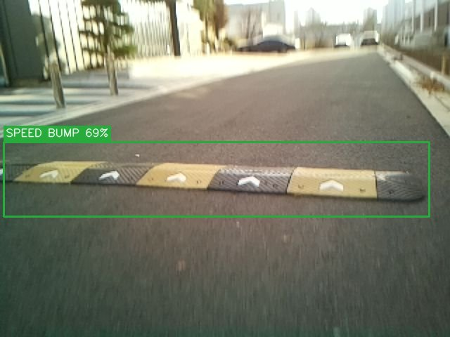 |
| bump | critical | 2 | 15:37:06 | [37.449766, 126.659012](https://www.google.com/maps?q=37.449766,126.659012) | 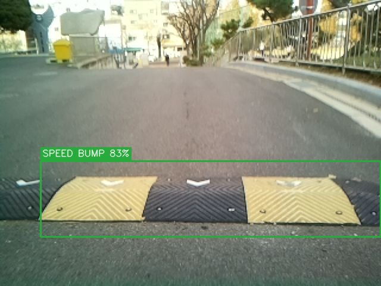 |
| bump | critical | 3 | 15:37:24 | [37.449836, 126.659024](https://www.google.com/maps?q=37.449836,126.659024) | 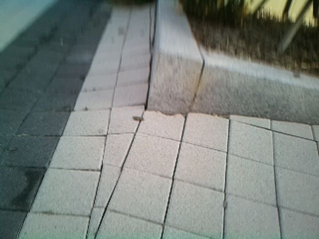 |
| bump | high | 5 | 15:37:27 | [37.449920, 126.659087](https://www.google.com/maps?q=37.449920,126.659087) | 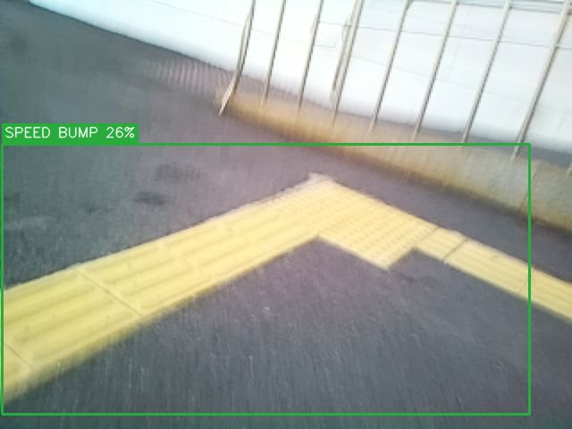 |
| bump | critical | 2 | 15:37:36 | [37.449867, 126.659094](https://www.google.com/maps?q=37.449867,126.659094) | 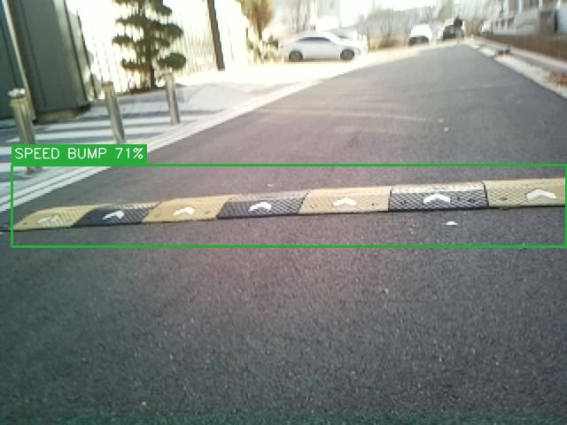 |
| bump | critical | 5 | 15:42:52 | [37.449770, 126.659139](https://www.google.com/maps?q=37.449770,126.659139) | 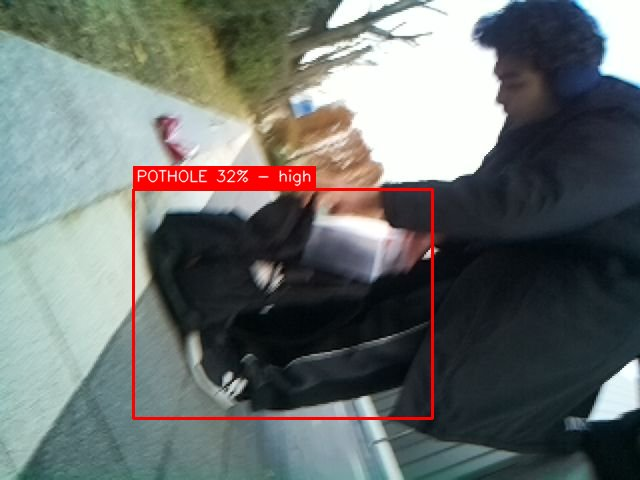 |
| bump | critical | 3 | 15:43:04 | [37.449728, 126.659105](https://www.google.com/maps?q=37.449728,126.659105) | 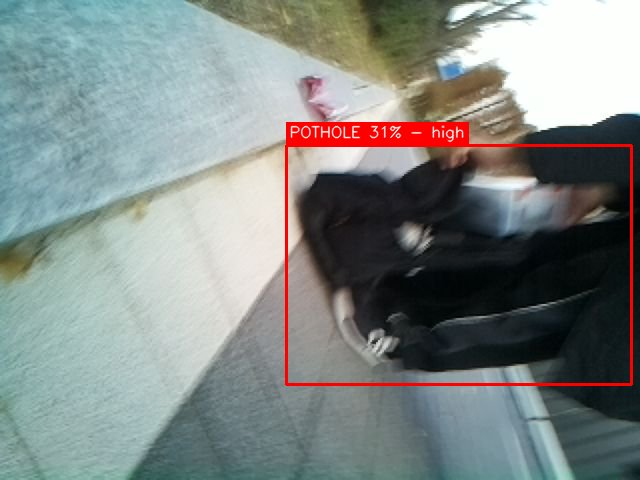 |
| pothole | high | 1 | 15:48:33 | [37.449685, 126.658790](https://www.google.com/maps?q=37.449685,126.658790) | 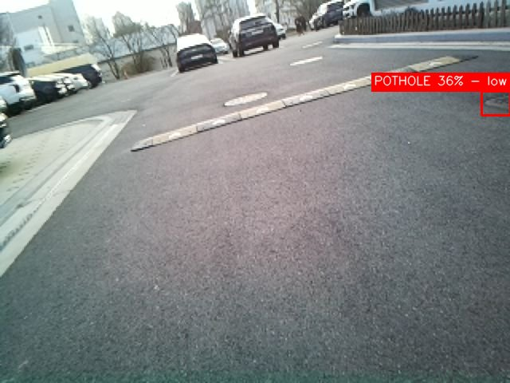 |
| pothole | medium | 2 | 15:49:30 | [37.449212, 126.658428](https://www.google.com/maps?q=37.449212,126.658428) | 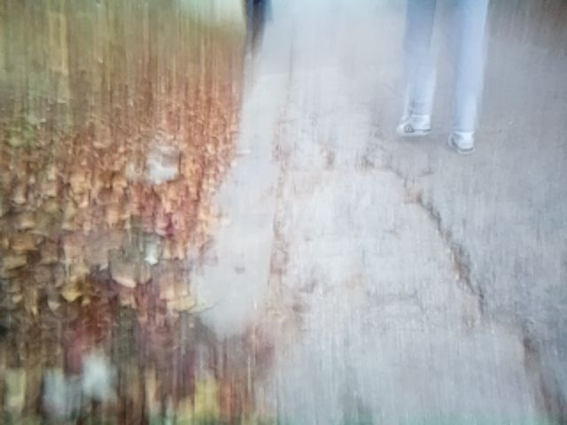 |
| pothole | high | 1 | 15:49:38 | [37.449112, 126.658461](https://www.google.com/maps?q=37.449112,126.658461) | 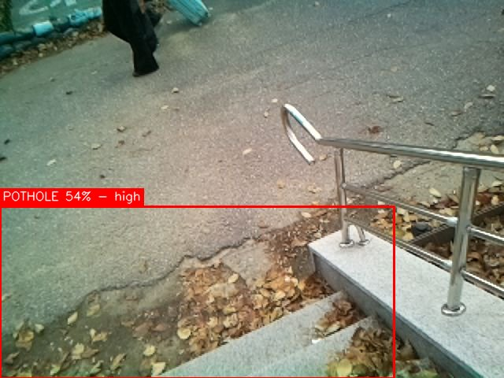 |
| pothole | critical | 3 | 15:51:51 | [37.449199, 126.658246](https://www.google.com/maps?q=37.449199,126.658246) | 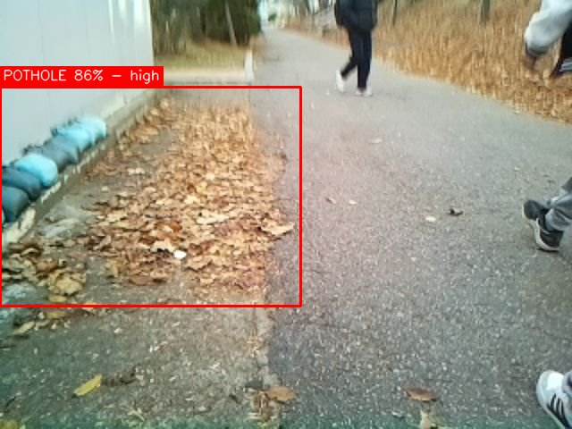 |
| pothole | critical | 1 | 15:52:13 | [37.449016, 126.658176](https://www.google.com/maps?q=37.449016,126.658176) | 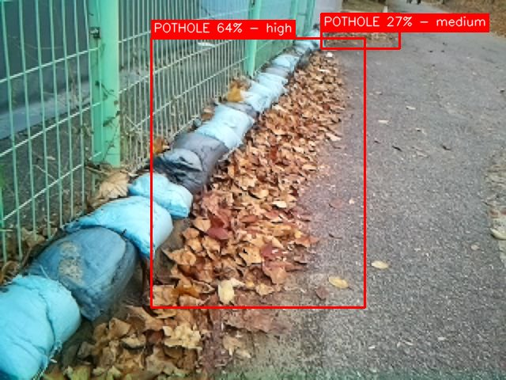 |
| pothole | critical | 2 | 15:53:32 | [37.449288, 126.658226](https://www.google.com/maps?q=37.449288,126.658226) | 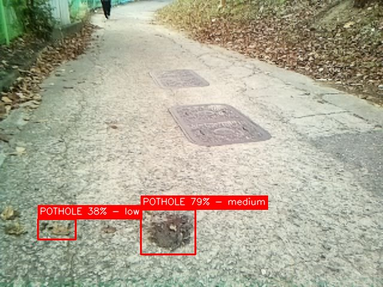 |
| pothole | critical | 4 | 15:53:34 | [37.449512, 126.658176](https://www.google.com/maps?q=37.449512,126.658176) | 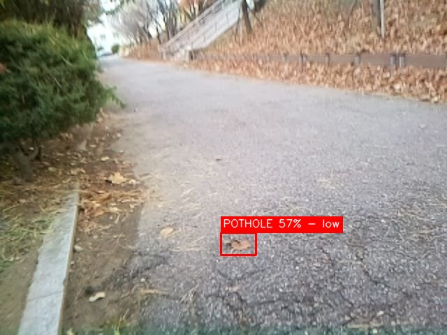 |
| pothole | critical | 3 | 15:54:28 | [37.449063, 126.658399](https://www.google.com/maps?q=37.449063,126.658399) | 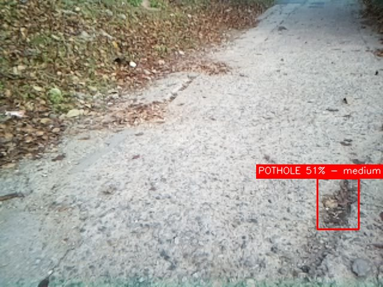 |
| pothole | high | 1 | 15:57:29 | [37.449562, 126.657872](https://www.google.com/maps?q=37.449562,126.657872) | 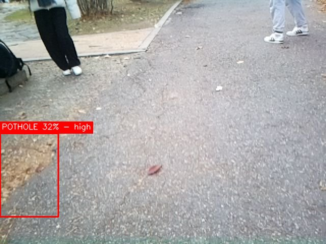 |
| pothole | low | 1 | 15:57:38 | [37.449515, 126.657893](https://www.google.com/maps?q=37.449515,126.657893) | 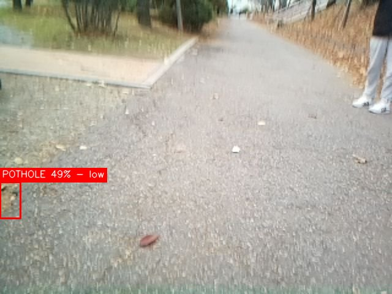 |
| pothole | critical | 4 | 15:59:10 | [37.449062, 126.658336](https://www.google.com/maps?q=37.449062,126.658336) | 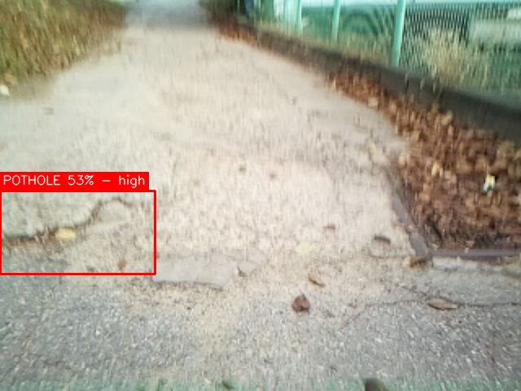 |
| pothole | high | 1 | 16:00:19 | [37.449109, 126.658874](https://www.google.com/maps?q=37.449109,126.658874) | 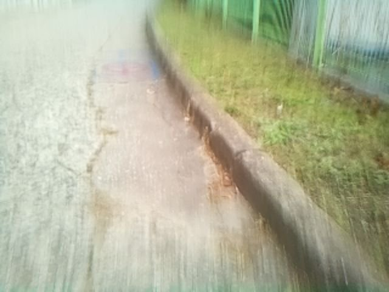 |
| pothole | medium | 1 | 16:01:39 | [37.448793, 126.658424](https://www.google.com/maps?q=37.448793,126.658424) | 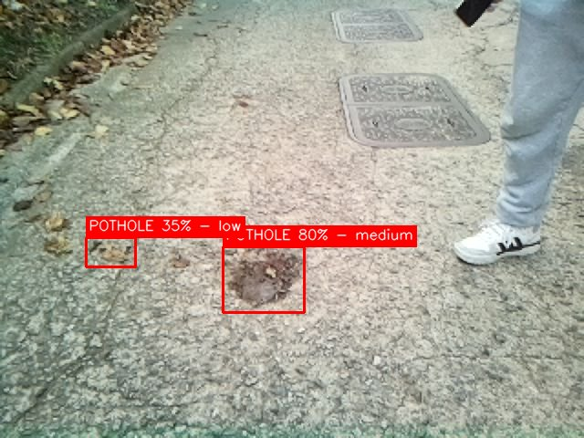 |
| pothole | medium | 1 | 16:02:07 | [37.448941, 126.658722](https://www.google.com/maps?q=37.448941,126.658722) | 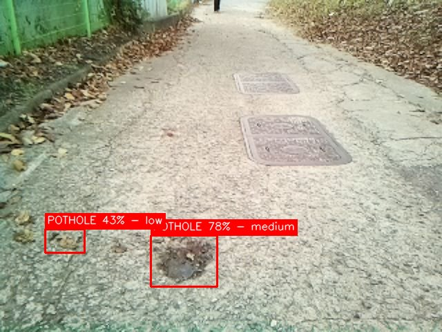 |
| pothole | medium | 2 | 16:02:24 | [37.449216, 126.658333](https://www.google.com/maps?q=37.449216,126.658333) | 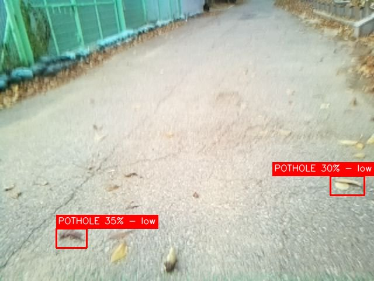 |
| pothole | low | 1 | 16:03:28 | [37.449209, 126.658131](https://www.google.com/maps?q=37.449209,126.658131) | 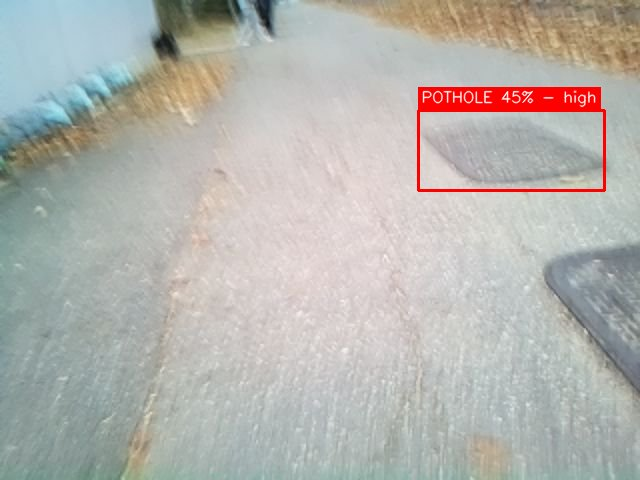 |

## Findings from 16:00 KST

| # | Time (KST) | Jolt | Peak g | Speed km/h | Camera verdict | Map | Location | Photo | Video |
|---|---|---|---|---|---|---|---|---|---|
| 1 | 16:00:15 | up | 0.56 | 6.6 | none | speed_bump not selected, not on the map | [37.449093, 126.658887](https://www.google.com/maps?q=37.449093,126.658887) | 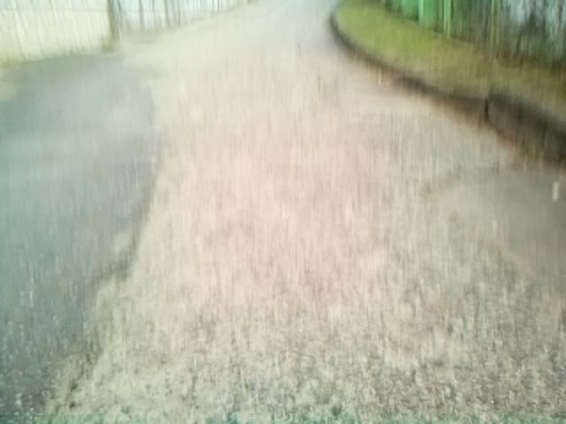 | [6.0 s](captures/20261125-160015-806_up.avi) |
| 2 | 16:00:17 | up | 0.61 | 4.5 | none | speed_bump not selected, not on the map | [37.449101, 126.658880](https://www.google.com/maps?q=37.449101,126.658880) | 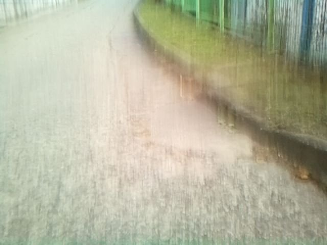 | [6.0 s](captures/20261125-160017-608_up.avi) |
| 3 | 16:00:19 | down | 1.57 | 3.2 | none | pothole (high) | [37.449109, 126.658874](https://www.google.com/maps?q=37.449109,126.658874) |  | [6.0 s](captures/20261125-160019-415_down.avi) |
| 4 | 16:00:21 | down | -0.55 | 2.8 | none | no GPS fix, not on the map | [37.449123, 126.658883](https://www.google.com/maps?q=37.449123,126.658883) | 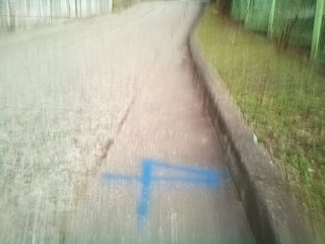 | [6.0 s](captures/20261125-160021-825_down.avi) |
| 5 | 16:00:23 | up | 0.92 | 2.8 | none | speed_bump not selected, not on the map | [37.449123, 126.658883](https://www.google.com/maps?q=37.449123,126.658883) | 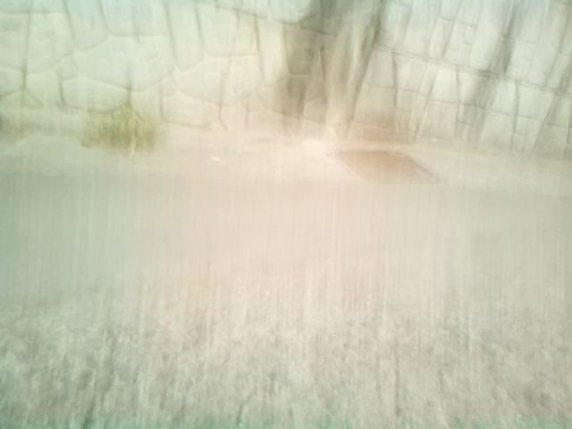 | [6.0 s](captures/20261125-160023-708_up.avi) |
| 6 | 16:00:25 | up | 1.39 | 2.8 | skipped | speed_bump not selected, not on the map | [37.449123, 126.658883](https://www.google.com/maps?q=37.449123,126.658883) | 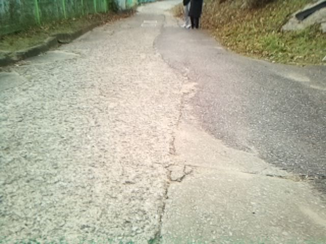 |  |
| 7 | 16:00:36 | up | -0.77 | 3.6 | none | speed_bump not selected, not on the map | [37.448973, 126.658903](https://www.google.com/maps?q=37.448973,126.658903) | 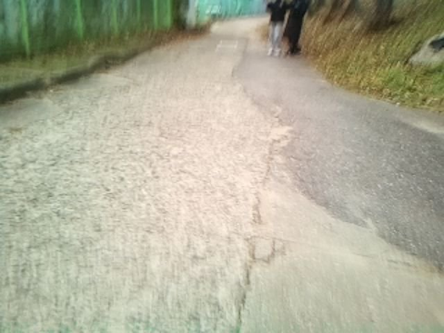 | [6.0 s](captures/20261125-160036-636_up.avi) |
| 8 | 16:00:46 | up | 1.3 | 2.7 | pothole (0.40) | no GPS fix, not on the map | [37.448953, 126.658947](https://www.google.com/maps?q=37.448953,126.658947) | 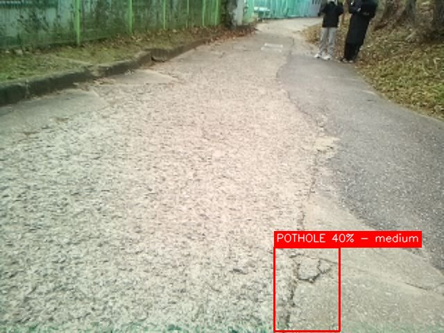 | [6.0 s](captures/20261125-160046-686_up.avi) |
| 9 | 16:00:48 | up | 0.92 | 2.7 | pothole (0.33) | no GPS fix, not on the map | [37.448953, 126.658947](https://www.google.com/maps?q=37.448953,126.658947) | 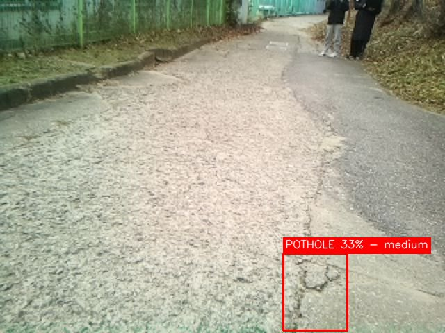 | [6.0 s](captures/20261125-160048-598_up.avi) |
| 10 | 16:00:50 | down | -0.89 | 2.7 | skipped | no GPS fix, not on the map | [37.448953, 126.658947](https://www.google.com/maps?q=37.448953,126.658947) | 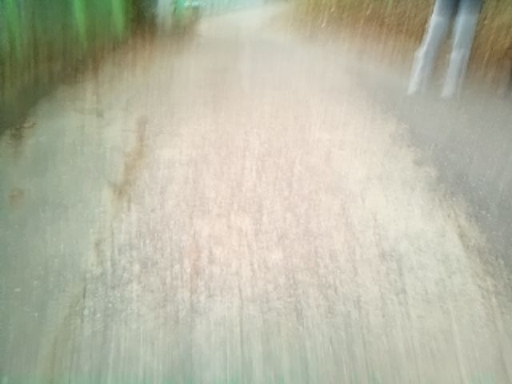 |  |
| 11 | 16:00:52 | down | 2.03 | 5.8 | skipped | no GPS fix, not on the map | [37.448801, 126.658956](https://www.google.com/maps?q=37.448801,126.658956) | 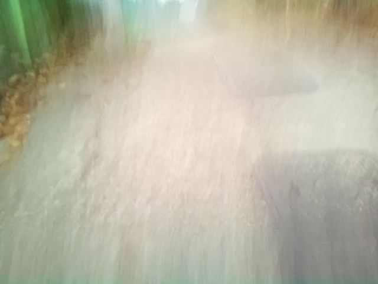 |  |
| 12 | 16:00:55 | down | 1.33 | 5.8 | pothole (0.68) | no GPS fix, not on the map | [37.448801, 126.658956](https://www.google.com/maps?q=37.448801,126.658956) | 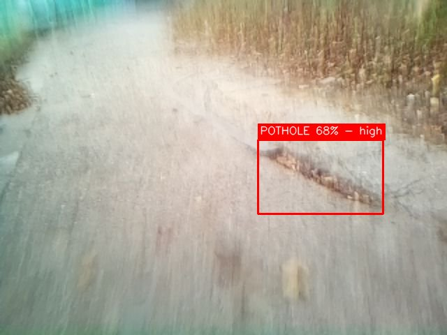 | [5.9 s](captures/20261125-160055-648_down.avi) |
| 13 | 16:00:57 | up | -0.68 | 4.3 | skipped | speed_bump not selected, not on the map | [37.448905, 126.658758](https://www.google.com/maps?q=37.448905,126.658758) | 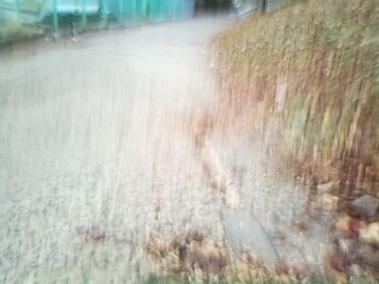 |  |
| 14 | 16:00:59 | up | -0.82 | 4.3 | skipped | speed_bump not selected, not on the map | [37.448905, 126.658758](https://www.google.com/maps?q=37.448905,126.658758) | 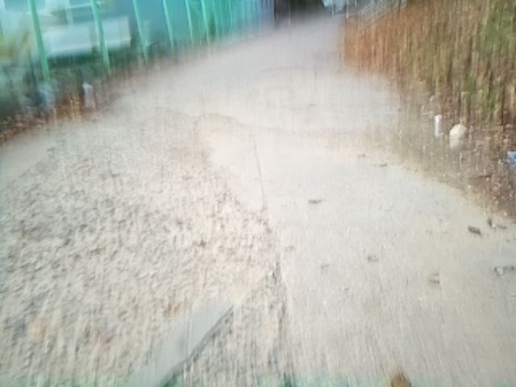 |  |
| 15 | 16:01:19 | up | 0.71 | 2.2 | pothole (0.48) | no GPS fix, not on the map | [37.448955, 126.658734](https://www.google.com/maps?q=37.448955,126.658734) | 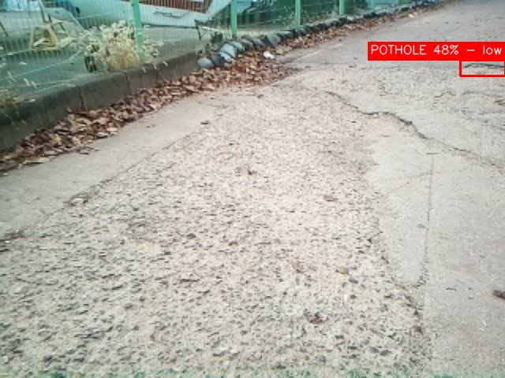 | [6.0 s](captures/20261125-160120-061_up.avi) |
| 16 | 16:01:22 | up | 0.88 | 2.2 | pothole (0.44) | no GPS fix, not on the map | [37.448955, 126.658734](https://www.google.com/maps?q=37.448955,126.658734) | 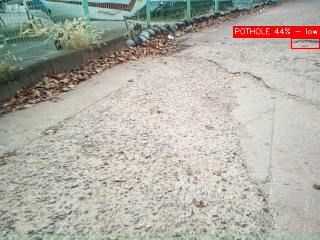 | [6.0 s](captures/20261125-160122-860_up.avi) |
| 17 | 16:01:24 | up | 0.73 | 2.2 | pothole (0.34) | no GPS fix, not on the map | [37.448955, 126.658734](https://www.google.com/maps?q=37.448955,126.658734) | 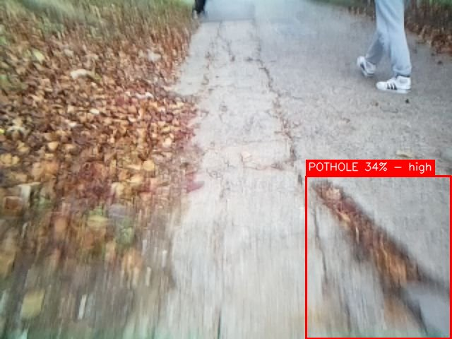 | [6.0 s](captures/20261125-160124-809_up.avi) |
| 18 | 16:01:26 | down | 0.84 | 6.4 | skipped | pothole (medium) | [37.449222, 126.658407](https://www.google.com/maps?q=37.449222,126.658407) |  |  |
| 19 | 16:01:28 | up | -0.86 | 6.1 | skipped | speed_bump not selected, not on the map | [37.449269, 126.658383](https://www.google.com/maps?q=37.449269,126.658383) | 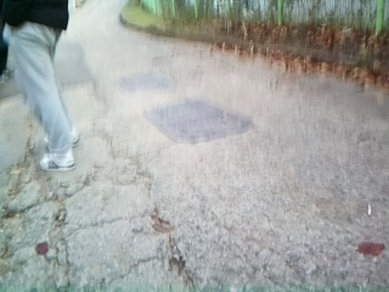 |  |
| 20 | 16:01:30 | up | 0.86 | 6.1 | pothole (0.61) | no GPS fix, not on the map | [37.449269, 126.658383](https://www.google.com/maps?q=37.449269,126.658383) | 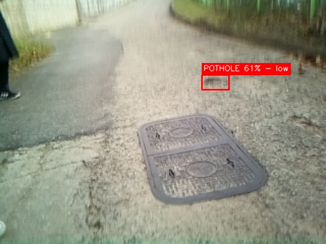 | [6.0 s](captures/20261125-160130-968_up.avi) |
| 21 | 16:01:32 | up | 1.26 | 6.1 | skipped | speed_bump not selected, not on the map | [37.449269, 126.658383](https://www.google.com/maps?q=37.449269,126.658383) | 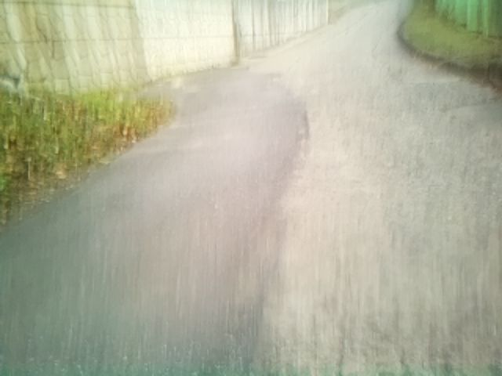 |  |
| 22 | 16:01:39 | up | 0.68 | 10.4 | pothole (0.80) | pothole (medium) | [37.448793, 126.658424](https://www.google.com/maps?q=37.448793,126.658424) |  | [6.0 s](captures/20261125-160139-888_up.avi) |
| 23 | 16:02:07 | up | 0.84 | 4.2 | pothole (0.78) | pothole (medium) | [37.448941, 126.658722](https://www.google.com/maps?q=37.448941,126.658722) |  | [5.9 s](captures/20261125-160207-462_up.avi) |
| 24 | 16:02:20 | up | 3.76 | 1.6 | pothole (0.80) | no GPS fix, not on the map | [37.448981, 126.658696](https://www.google.com/maps?q=37.448981,126.658696) | 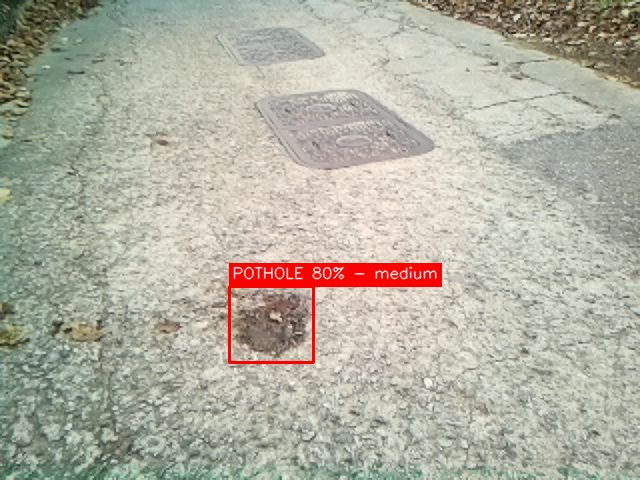 | [6.0 s](captures/20261125-160220-840_up.avi) |
| 25 | 16:02:24 | up | 0.58 | 16.2 | pothole (0.80) | pothole (low) | [37.449212, 126.658334](https://www.google.com/maps?q=37.449212,126.658334) | 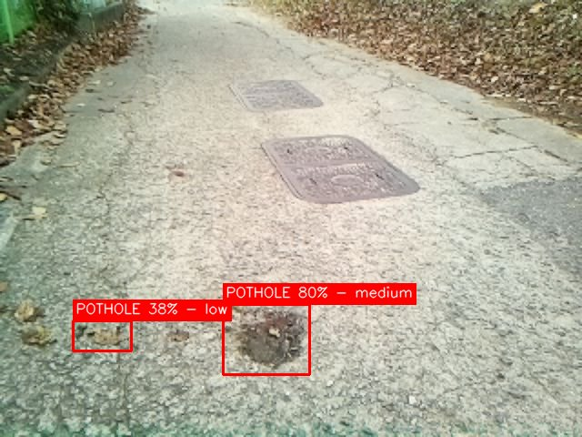 | [6.0 s](captures/20261125-160224-891_up.avi) |
| 26 | 16:02:29 | up | 1.63 | 14.0 | pothole (0.79) | pothole (critical) | [37.449304, 126.658232](https://www.google.com/maps?q=37.449304,126.658232) |  | [6.0 s](captures/20261125-160229-652_up.avi) |
| 27 | 16:02:46 | up | 0.51 | 1.2 | pothole (0.27) | no GPS fix, not on the map | [37.449245, 126.658333](https://www.google.com/maps?q=37.449245,126.658333) | 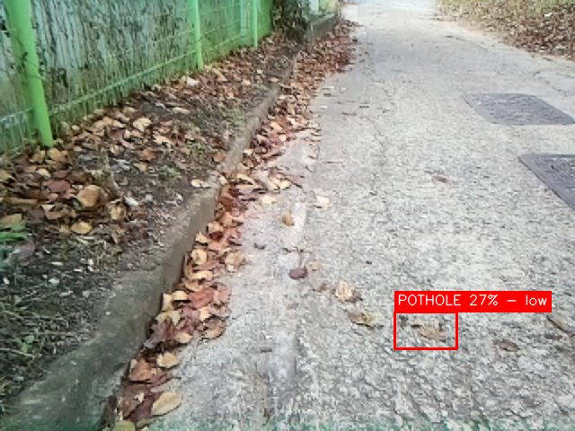 | [6.0 s](captures/20261125-160246-972_up.avi) |
| 28 | 16:02:48 | up | 1.17 | 1.2 | pothole (0.55) | no GPS fix, not on the map | [37.449245, 126.658333](https://www.google.com/maps?q=37.449245,126.658333) | 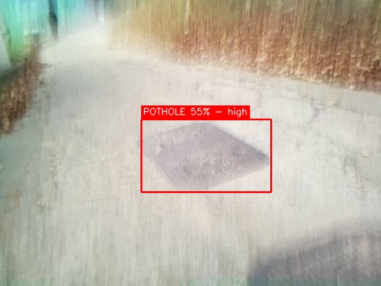 | [6.0 s](captures/20261125-160248-972_up.avi) |
| 29 | 16:02:55 | down | -1.06 | 1.2 | pothole (0.56) | no GPS fix, not on the map | [37.449245, 126.658333](https://www.google.com/maps?q=37.449245,126.658333) | 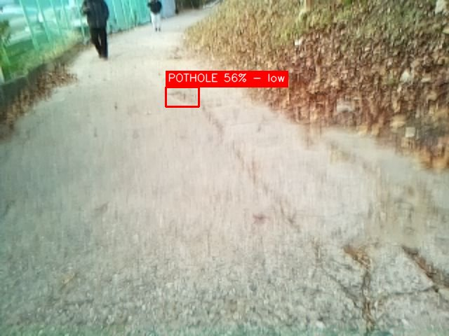 | [6.0 s](captures/20261125-160255-981_down.avi) |
| 30 | 16:02:57 | up | 0.95 | 1.2 | pothole (0.63) | no GPS fix, not on the map | [37.449245, 126.658333](https://www.google.com/maps?q=37.449245,126.658333) | 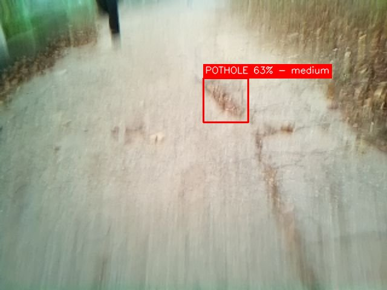 | [6.0 s](captures/20261125-160258-024_up.avi) |
| 31 | 16:02:59 | up | 0.85 | 1.2 | pothole (0.80) | no GPS fix, not on the map | [37.449245, 126.658333](https://www.google.com/maps?q=37.449245,126.658333) | 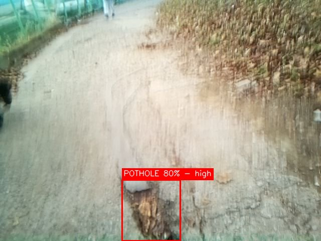 | [6.0 s](captures/20261125-160300-112_up.avi) |
| 32 | 16:03:02 | up | 0.84 | 1.2 | skipped | speed_bump not selected, not on the map | [37.449245, 126.658333](https://www.google.com/maps?q=37.449245,126.658333) | 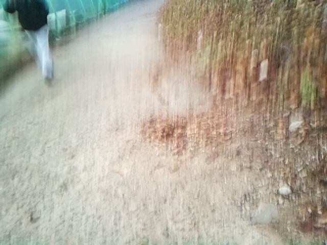 |  |
| 33 | 16:03:03 | up | 0.77 | 1.2 | skipped | speed_bump not selected, not on the map | [37.449245, 126.658333](https://www.google.com/maps?q=37.449245,126.658333) |  |  |
| 34 | 16:03:05 | up | 0.73 | 1.2 | skipped | speed_bump not selected, not on the map | [37.449245, 126.658333](https://www.google.com/maps?q=37.449245,126.658333) |  |  |
| 35 | 16:03:08 | down | 0.9 | 1.2 | pothole (0.29) | no GPS fix, not on the map | [37.449245, 126.658333](https://www.google.com/maps?q=37.449245,126.658333) |  | [6.0 s](captures/20261125-160308-711_down.avi) |
| 36 | 16:03:10 | up | 1.47 | 1.2 | skipped | speed_bump not selected, not on the map | [37.449245, 126.658333](https://www.google.com/maps?q=37.449245,126.658333) |  |  |
| 37 | 16:03:15 | down | -0.92 | 1.2 | skipped | no GPS fix, not on the map | [37.449245, 126.658333](https://www.google.com/maps?q=37.449245,126.658333) |  |  |
| 38 | 16:03:18 | up | 0.77 | 6.5 | pothole (0.35) | pothole (medium) | [37.449220, 126.658331](https://www.google.com/maps?q=37.449220,126.658331) |  | [6.0 s](captures/20261125-160318-892_up.avi) |
| 39 | 16:03:22 | up | 0.63 | 5.1 | skipped | speed_bump not selected, not on the map | [37.449188, 126.658329](https://www.google.com/maps?q=37.449188,126.658329) |  |  |
| 40 | 16:03:25 | up | 0.95 | 11.7 | skipped | speed_bump not selected, not on the map | [37.449071, 126.658248](https://www.google.com/maps?q=37.449071,126.658248) |  |  |
| 41 | 16:03:28 | up | 0.53 | 15.4 | pothole (0.45) | pothole (low) | [37.449209, 126.658131](https://www.google.com/maps?q=37.449209,126.658131) |  | [6.0 s](captures/20261125-160328-412_up.avi) |

## Every jolt

| # | Time (KST) | Jolt | Peak g | Speed km/h | Camera verdict | Map | Location | Photo | Video |
|---|---|---|---|---|---|---|---|---|---|
| 1 | 15:14:27 | down | -0.9 | 12.0 | pothole (0.56) | pothole (medium) | [37.449911, 126.659158](https://www.google.com/maps?q=37.449911,126.659158) |  | [3.9 s](captures/20261125-151428-083_down.avi) |
| 2 | 15:15:11 | up | 0.42 | 0.7 | speed_bump (0.77) | bump (low) | [37.449800, 126.659152](https://www.google.com/maps?q=37.449800,126.659152) |  | [6.0 s](captures/20261125-151511-979_up.avi) |
| 3 | 15:15:14 | up | 0.59 | 2.0 | speed_bump (0.77) | bump (low) | [37.449801, 126.659161](https://www.google.com/maps?q=37.449801,126.659161) |  | [6.0 s](captures/20261125-151515-210_up.avi) |
| 4 | 15:15:16 | up | 0.43 | 2.8 | speed_bump (0.72) | bump (low) | [37.449809, 126.659177](https://www.google.com/maps?q=37.449809,126.659177) |  | [6.0 s](captures/20261125-151517-219_up.avi) |
| 5 | 15:15:35 | up | -1.07 | 9.4 | crack (0.40) | pothole (high) | [37.449953, 126.659167](https://www.google.com/maps?q=37.449953,126.659167) |  | [6.0 s](captures/20261125-151535-449_up.avi) |
| 6 | 15:15:38 | up | 0.58 | 3.9 | crack (0.15) | pothole (high) | [37.449971, 126.659165](https://www.google.com/maps?q=37.449971,126.659165) |  | [6.0 s](captures/20261125-151538-580_up.avi) |
| 7 | 15:15:41 | up | 0.42 | 8.1 | crack (0.21) | bump (low) | [37.449900, 126.659184](https://www.google.com/maps?q=37.449900,126.659184) |  | [6.0 s](captures/20261125-151541-390_up.avi) |
| 8 | 15:16:02 | down | -0.41 | 7.3 | pothole (0.62) | pothole (low) | [37.449716, 126.659262](https://www.google.com/maps?q=37.449716,126.659262) |  | [6.0 s](captures/20261125-151602-810_down.avi) |
| 9 | 15:16:14 | up | 0.49 | 2.3 | pothole (0.61) | bump (low) | [37.449779, 126.659166](https://www.google.com/maps?q=37.449779,126.659166) |  | [6.0 s](captures/20261125-151615-209_up.avi) |
| 10 | 15:16:25 | up | -0.73 | 0.7 | speed_bump (0.71) | bump (medium) | [37.449778, 126.659148](https://www.google.com/maps?q=37.449778,126.659148) |  | [6.0 s](captures/20261125-151626-059_up.avi) |
| 11 | 15:16:28 | down | -0.6 | 2.5 | speed_bump (0.75) | bump (medium) | [37.449788, 126.659195](https://www.google.com/maps?q=37.449788,126.659195) |  | [6.0 s](captures/20261125-151628-550_down.avi) |
| 12 | 15:17:58 | manual |  | 1.5 | none |  | [37.449672, 126.659230](https://www.google.com/maps?q=37.449672,126.659230) |  |  |
| 13 | 15:20:42 | up | 0.69 | 0.9 | none | bump (medium) | [37.449692, 126.659169](https://www.google.com/maps?q=37.449692,126.659169) |  | [6.0 s](captures/20261125-152043-019_up.avi) |
| 14 | 15:20:44 | down | -0.46 | 2.2 | speed_bump (0.49) | bump (medium) | [37.449699, 126.659163](https://www.google.com/maps?q=37.449699,126.659163) |  | [6.0 s](captures/20261125-152045-239_down.avi) |
| 15 | 15:20:56 | up | 0.86 | 7.7 | pothole (0.34) | pothole (medium) | [37.449913, 126.659271](https://www.google.com/maps?q=37.449913,126.659271) |  | [6.0 s](captures/20261125-152056-669_up.avi) |
| 16 | 15:22:05 | up | 0.41 | 2.5 | none | bump (low) | [37.449966, 126.659026](https://www.google.com/maps?q=37.449966,126.659026) |  | [6.0 s](captures/20261125-152205-499_up.avi) |
| 17 | 15:22:07 | up | 0.43 | 1.7 | none | bump (low) | [37.449959, 126.659040](https://www.google.com/maps?q=37.449959,126.659040) |  | [6.0 s](captures/20261125-152208-099_up.avi) |
| 18 | 15:22:35 | up | 0.42 | 0.4 | pothole (0.55) | pothole (low) | [37.449721, 126.659024](https://www.google.com/maps?q=37.449721,126.659024) |  | [6.0 s](captures/20261125-152235-730_up.avi) |
| 19 | 15:22:46 | up | 0.44 | 2.6 | none | no GPS fix, not on the map | [37.449712, 126.659071](https://www.google.com/maps?q=37.449712,126.659071) |  | [6.0 s](captures/20261125-152246-590_up.avi) |
| 20 | 15:22:57 | up | 0.56 | 53.9 | none | no GPS fix, not on the map | [37.450484, 126.659273](https://www.google.com/maps?q=37.450484,126.659273) |  | [6.0 s](captures/20261125-152258-230_up.avi) |
| 21 | 15:23:00 | up | 1.07 | 53.9 | none | no GPS fix, not on the map | [37.450484, 126.659273](https://www.google.com/maps?q=37.450484,126.659273) |  | [5.9 s](captures/20261125-152300-961_up.avi) |
| 22 | 15:23:02 | up | 1.02 | 53.9 | pothole (0.30) | no GPS fix, not on the map | [37.450484, 126.659273](https://www.google.com/maps?q=37.450484,126.659273) |  | [6.0 s](captures/20261125-152302-811_up.avi) |
| 23 | 15:23:48 | down | -0.74 | 3.7 | pothole (0.36) | pothole (medium) | [37.449764, 126.659340](https://www.google.com/maps?q=37.449764,126.659340) |  | [6.0 s](captures/20261125-152348-821_down.avi) |
| 24 | 15:23:58 | down | -0.43 | 2.3 | pothole (0.27) | pothole (low) | [37.449753, 126.659223](https://www.google.com/maps?q=37.449753,126.659223) |  | [6.0 s](captures/20261125-152358-860_down.avi) |
| 25 | 15:24:32 | up | 0.83 | 8.0 | pothole (0.46) | pothole (medium) | [37.449669, 126.659405](https://www.google.com/maps?q=37.449669,126.659405) |  | [6.0 s](captures/20261125-152432-921_up.avi) |
| 26 | 15:24:42 | up | 0.68 | 2.8 | crack (0.18) | bump (medium) | [37.449585, 126.659318](https://www.google.com/maps?q=37.449585,126.659318) |  | [6.0 s](captures/20261125-152443-030_up.avi) |
| 27 | 15:24:45 | up | 0.52 | 0.8 | none | pothole (low) | [37.449676, 126.659255](https://www.google.com/maps?q=37.449676,126.659255) |  | [6.0 s](captures/20261125-152445-654_up.avi) |
| 28 | 15:25:26 | up | 2.14 | 0.3 | crack (0.26) | bump (critical) | [37.449782, 126.659128](https://www.google.com/maps?q=37.449782,126.659128) |  | [6.0 s](captures/20261125-152527-071_up.avi) |
| 29 | 15:25:30 | up | 0.92 | 1.1 | speed_bump (0.29) | bump (critical) | [37.449782, 126.659138](https://www.google.com/maps?q=37.449782,126.659138) |  | [6.0 s](captures/20261125-152530-735_up.avi) |
| 30 | 15:26:35 | up | 0.43 | 0.3 | crack (0.57) | pothole (low) | [37.449722, 126.659228](https://www.google.com/maps?q=37.449722,126.659228) |  | [6.0 s](captures/20261125-152635-462_up.avi) |
| 31 | 15:27:34 | up | 0.54 | 2.0 | speed_bump (0.16) | bump (low) | [37.449835, 126.659038](https://www.google.com/maps?q=37.449835,126.659038) |  | [6.0 s](captures/20261125-152734-622_up.avi) |
| 32 | 15:27:45 | up | 1.06 | 6.4 | speed_bump (0.73) | bump (high) | [37.449830, 126.659050](https://www.google.com/maps?q=37.449830,126.659050) |  | [6.0 s](captures/20261125-152746-161_up.avi) |
| 33 | 15:27:50 | down | 0.64 | 8.5 | pothole (0.58) | pothole (medium) | [37.449858, 126.659107](https://www.google.com/maps?q=37.449858,126.659107) |  | [6.0 s](captures/20261125-152750-483_down.avi) |
| 34 | 15:27:52 | down | -0.54 | 1.2 | pothole (0.64) | pothole (medium) | [37.449865, 126.659115](https://www.google.com/maps?q=37.449865,126.659115) |  | [6.0 s](captures/20261125-152752-374_down.avi) |
| 35 | 15:27:55 | up | 1.22 | 2.5 | speed_bump (0.69) | pothole (high) | [37.449853, 126.659117](https://www.google.com/maps?q=37.449853,126.659117) |  | [6.0 s](captures/20261125-152755-552_up.avi) |
| 36 | 15:27:58 | down | -1.09 | 4.7 | speed_bump (0.69) | bump (high) | [37.449804, 126.659095](https://www.google.com/maps?q=37.449804,126.659095) |  | [6.0 s](captures/20261125-152759-074_down.avi) |
| 37 | 15:29:45 | down | -0.62 | 0.3 | none | pothole (high) | [37.449843, 126.659119](https://www.google.com/maps?q=37.449843,126.659119) |  | [6.0 s](captures/20261125-152945-825_down.avi) |
| 38 | 15:30:16 | up | 0.5 | 2.0 | crack (0.73) | bump (low) | [37.449720, 126.659159](https://www.google.com/maps?q=37.449720,126.659159) |  | [6.0 s](captures/20261125-153016-806_up.avi) |
| 39 | 15:37:02 | down | -0.4 | 4.2 | none | pothole not selected, not on the map | [37.449776, 126.659033](https://www.google.com/maps?q=37.449776,126.659033) |  | [6.0 s](captures/20261125-153702-672_down.avi) |
| 40 | 15:37:06 | up | 0.6 | 2.3 | speed_bump (0.30) | bump (medium) | [37.449757, 126.659015](https://www.google.com/maps?q=37.449757,126.659015) |  | [6.0 s](captures/20261125-153706-993_up.avi) |
| 41 | 15:37:14 | down | -0.48 | 2.0 | none | pothole not selected, not on the map | [37.449696, 126.658952](https://www.google.com/maps?q=37.449696,126.658952) |  | [5.9 s](captures/20261125-153714-432_down.avi) |
| 42 | 15:37:20 | up | 2.08 | 8.6 | speed_bump (0.83) | bump (critical) | [37.449775, 126.659010](https://www.google.com/maps?q=37.449775,126.659010) |  | [6.0 s](captures/20261125-153720-772_up.avi) |
| 43 | 15:37:24 | down | 0.8 | 10.0 | speed_bump (0.67) | bump (medium) | [37.449842, 126.659041](https://www.google.com/maps?q=37.449842,126.659041) |  | [6.0 s](captures/20261125-153724-515_down.avi) |
| 44 | 15:37:27 | up | 0.41 | 11.6 | none | bump (low) | [37.449931, 126.659101](https://www.google.com/maps?q=37.449931,126.659101) |  | [6.0 s](captures/20261125-153728-104_up.avi) |
| 45 | 15:37:30 | up | -0.54 | 3.6 | speed_bump (0.28) | bump (low) | [37.449917, 126.659113](https://www.google.com/maps?q=37.449917,126.659113) |  | [6.0 s](captures/20261125-153730-392_up.avi) |
| 46 | 15:37:32 | up | 0.58 | 2.6 | none | bump (low) | [37.449919, 126.659082](https://www.google.com/maps?q=37.449919,126.659082) |  | [6.0 s](captures/20261125-153732-772_up.avi) |
| 47 | 15:37:36 | up | -0.69 | 5.1 | none | bump (medium) | [37.449877, 126.659088](https://www.google.com/maps?q=37.449877,126.659088) |  | [6.0 s](captures/20261125-153736-492_up.avi) |
| 48 | 15:37:39 | up | 1.92 | 6.9 | speed_bump (0.65) | bump (critical) | [37.449849, 126.658990](https://www.google.com/maps?q=37.449849,126.658990) |  | [6.0 s](captures/20261125-153739-722_up.avi) |
| 49 | 15:37:41 | down | 0.85 | 4.6 | skipped | pothole not selected, not on the map | [37.449830, 126.658964](https://www.google.com/maps?q=37.449830,126.658964) |  |  |
| 50 | 15:42:52 | up | 1.13 | 2.6 | none | bump (high) | [37.449787, 126.659160](https://www.google.com/maps?q=37.449787,126.659160) |  | [6.0 s](captures/20261125-154252-924_up.avi) |
| 51 | 15:42:57 | up | 0.54 | 3.4 | speed_bump (0.62) | bump (high) | [37.449776, 126.659135](https://www.google.com/maps?q=37.449776,126.659135) |  | [6.0 s](captures/20261125-154257-715_up.avi) |
| 52 | 15:42:59 | up | 1.5 | 2.7 | speed_bump (0.36) | bump (high) | [37.449760, 126.659127](https://www.google.com/maps?q=37.449760,126.659127) |  | [6.0 s](captures/20261125-154259-985_up.avi) |
| 53 | 15:43:04 | up | 1.17 | 2.3 | none | bump (high) | [37.449710, 126.659083](https://www.google.com/maps?q=37.449710,126.659083) |  | [6.0 s](captures/20261125-154305-215_up.avi) |
| 54 | 15:43:07 | up | 0.75 | 6.7 | speed_bump (0.16) | bump (high) | [37.449739, 126.659097](https://www.google.com/maps?q=37.449739,126.659097) |  | [6.0 s](captures/20261125-154307-865_up.avi) |
| 55 | 15:43:09 | up | 2.23 | 9.0 | speed_bump (0.69) | bump (critical) | [37.449773, 126.659121](https://www.google.com/maps?q=37.449773,126.659121) |  | [6.0 s](captures/20261125-154310-056_up.avi) |
| 56 | 15:43:17 | up | 1.02 | 4.1 | none | bump (high) | [37.449925, 126.659073](https://www.google.com/maps?q=37.449925,126.659073) |  | [6.0 s](captures/20261125-154317-417_up.avi) |
| 57 | 15:43:19 | up | 1.15 | 2.2 | speed_bump (0.26) | bump (high) | [37.449908, 126.659067](https://www.google.com/maps?q=37.449908,126.659067) |  | [5.9 s](captures/20261125-154319-767_up.avi) |
| 58 | 15:43:24 | up | 2.27 | 2.6 | speed_bump (0.71) | bump (critical) | [37.449856, 126.659101](https://www.google.com/maps?q=37.449856,126.659101) |  | [6.0 s](captures/20261125-154324-765_up.avi) |
| 59 | 15:43:28 | up | 0.98 | 5.0 | skipped | bump (critical) | [37.449818, 126.659041](https://www.google.com/maps?q=37.449818,126.659041) |  |  |
| 60 | 15:43:31 | down | -0.78 | 5.7 | none | pothole not selected, not on the map | [37.449810, 126.659069](https://www.google.com/maps?q=37.449810,126.659069) |  | [6.0 s](captures/20261125-154332-147_down.avi) |
| 61 | 15:47:42 | up | 3.9 | 1.3 | pothole (0.31) | bump (critical) | [37.449736, 126.659133](https://www.google.com/maps?q=37.449736,126.659133) |  | [6.0 s](captures/20261125-154742-689_up.avi) |
| 62 | 15:47:46 | down | -0.58 | 5.6 | pothole (0.32) | bump (critical) | [37.449755, 126.659155](https://www.google.com/maps?q=37.449755,126.659155) |  | [6.0 s](captures/20261125-154747-029_down.avi) |
| 63 | 15:48:14 | up | 0.6 | 3.6 | none | speed_bump not selected, not on the map | [37.449833, 126.659016](https://www.google.com/maps?q=37.449833,126.659016) |  | [6.0 s](captures/20261125-154814-829_up.avi) |
| 64 | 15:48:16 | up | 0.96 | 2.8 | none | speed_bump not selected, not on the map | [37.449826, 126.658994](https://www.google.com/maps?q=37.449826,126.658994) |  | [6.0 s](captures/20261125-154817-020_up.avi) |
| 65 | 15:48:33 | up | 1.16 | 4.6 | pothole (0.36) | pothole (high) | [37.449685, 126.658790](https://www.google.com/maps?q=37.449685,126.658790) |  | [6.0 s](captures/20261125-154833-549_up.avi) |
| 66 | 15:49:23 | up | 0.79 | 3.0 | none | speed_bump not selected, not on the map | [37.449379, 126.658449](https://www.google.com/maps?q=37.449379,126.658449) |  | [6.0 s](captures/20261125-154923-649_up.avi) |
| 67 | 15:49:30 | up | 0.82 | 7.7 | pothole (0.33) | pothole (medium) | [37.449202, 126.658448](https://www.google.com/maps?q=37.449202,126.658448) |  | [6.0 s](captures/20261125-154930-370_up.avi) |
| 68 | 15:49:38 | up | 1.02 | 5.0 | pothole (0.54) | pothole (high) | [37.449112, 126.658461](https://www.google.com/maps?q=37.449112,126.658461) |  | [6.0 s](captures/20261125-154938-500_up.avi) |
| 69 | 15:51:51 | up | 0.65 | 0.3 | pothole (0.53) | pothole (medium) | [37.449190, 126.658257](https://www.google.com/maps?q=37.449190,126.658257) |  | [6.0 s](captures/20261125-155151-639_up.avi) |
| 70 | 15:52:13 | up | 2.36 | 2.0 | pothole (0.64) | pothole (critical) | [37.449016, 126.658176](https://www.google.com/maps?q=37.449016,126.658176) |  | [6.0 s](captures/20261125-155213-910_up.avi) |
| 71 | 15:53:22 | up | 1.82 | 6.1 | pothole (0.36) | pothole (critical) | [37.449186, 126.658246](https://www.google.com/maps?q=37.449186,126.658246) |  | [6.0 s](captures/20261125-155322-790_up.avi) |
| 72 | 15:53:25 | up | 1.68 | 5.7 | pothole (0.86) | pothole (critical) | [37.449219, 126.658233](https://www.google.com/maps?q=37.449219,126.658233) |  | [6.0 s](captures/20261125-155326-000_up.avi) |
| 73 | 15:53:32 | up | 0.57 | 6.6 | pothole (0.51) | pothole (low) | [37.449273, 126.658221](https://www.google.com/maps?q=37.449273,126.658221) |  | [6.0 s](captures/20261125-155332-780_up.avi) |
| 74 | 15:53:34 | up | 0.76 | 19.0 | pothole (0.45) | pothole (medium) | [37.449529, 126.658176](https://www.google.com/maps?q=37.449529,126.658176) |  | [6.0 s](captures/20261125-155334-681_up.avi) |
| 75 | 15:53:41 | up | 0.69 | 2.5 | pothole (0.64) | pothole (medium) | [37.449517, 126.658203](https://www.google.com/maps?q=37.449517,126.658203) |  | [6.0 s](captures/20261125-155341-840_up.avi) |
| 76 | 15:53:44 | up | 1.62 | 5.0 | pothole (0.55) | pothole (critical) | [37.449513, 126.658176](https://www.google.com/maps?q=37.449513,126.658176) |  | [6.0 s](captures/20261125-155344-410_up.avi) |
| 77 | 15:53:46 | up | 1.69 | 4.5 | pothole (0.57) | pothole (critical) | [37.449489, 126.658150](https://www.google.com/maps?q=37.449489,126.658150) |  | [6.0 s](captures/20261125-155346-401_up.avi) |
| 78 | 15:54:28 | up | 0.56 | 3.8 | pothole (0.64) | pothole (low) | [37.449082, 126.658372](https://www.google.com/maps?q=37.449082,126.658372) |  | [6.0 s](captures/20261125-155428-700_up.avi) |
| 79 | 15:57:29 | up | 1.16 | 10.1 | pothole (0.32) | pothole (high) | [37.449562, 126.657872](https://www.google.com/maps?q=37.449562,126.657872) |  | [6.0 s](captures/20261125-155729-990_up.avi) |
| 80 | 15:57:38 | up | 0.52 | 3.6 | pothole (0.49) | pothole (low) | [37.449515, 126.657893](https://www.google.com/maps?q=37.449515,126.657893) |  | [5.9 s](captures/20261125-155739-023_up.avi) |
| 81 | 15:57:40 | up | 3.48 | 3.5 | pothole (0.62) | no GPS fix, not on the map | [37.449510, 126.657889](https://www.google.com/maps?q=37.449510,126.657889) |  | [6.0 s](captures/20261125-155741-141_up.avi) |
| 82 | 15:57:47 | up | 0.89 | 3.5 | none | speed_bump not selected, not on the map | [37.449510, 126.657889](https://www.google.com/maps?q=37.449510,126.657889) |  | [6.0 s](captures/20261125-155747-551_up.avi) |
| 83 | 15:57:54 | up | 2.53 | 3.5 | pothole (0.46) | no GPS fix, not on the map | [37.449510, 126.657889](https://www.google.com/maps?q=37.449510,126.657889) |  | [6.0 s](captures/20261125-155754-662_up.avi) |
| 84 | 15:57:59 | up | 0.51 | 3.5 | none | speed_bump not selected, not on the map | [37.449510, 126.657889](https://www.google.com/maps?q=37.449510,126.657889) |  | [6.0 s](captures/20261125-155759-663_up.avi) |
| 85 | 15:58:02 | down | 0.98 | 3.5 | none | no GPS fix, not on the map | [37.449510, 126.657889](https://www.google.com/maps?q=37.449510,126.657889) |  | [6.0 s](captures/20261125-155802-450_down.avi) |
| 86 | 15:58:06 | up | 0.56 | 3.5 | none | speed_bump not selected, not on the map | [37.449510, 126.657889](https://www.google.com/maps?q=37.449510,126.657889) |  | [6.0 s](captures/20261125-155806-520_up.avi) |
| 87 | 15:58:08 | up | 0.54 | 3.5 | pothole (0.49) | no GPS fix, not on the map | [37.449510, 126.657889](https://www.google.com/maps?q=37.449510,126.657889) |  | [6.0 s](captures/20261125-155808-941_up.avi) |
| 88 | 15:58:13 | up | 0.52 | 3.5 | pothole (0.68) | no GPS fix, not on the map | [37.449510, 126.657889](https://www.google.com/maps?q=37.449510,126.657889) |  | [6.0 s](captures/20261125-155813-951_up.avi) |
| 89 | 15:58:55 | up | 0.65 | 3.5 | pothole (0.73) | no GPS fix, not on the map | [37.449510, 126.657889](https://www.google.com/maps?q=37.449510,126.657889) |  | [6.0 s](captures/20261125-155856-226_up.avi) |
| 90 | 15:58:57 | up | 0.8 | 3.5 | pothole (0.71) | no GPS fix, not on the map | [37.449510, 126.657889](https://www.google.com/maps?q=37.449510,126.657889) |  | [6.0 s](captures/20261125-155858-035_up.avi) |
| 91 | 15:59:00 | up | 0.58 | 3.5 | pothole (0.63) | no GPS fix, not on the map | [37.449510, 126.657889](https://www.google.com/maps?q=37.449510,126.657889) |  | [6.0 s](captures/20261125-155900-738_up.avi) |
| 92 | 15:59:06 | up | -0.67 | 3.5 | pothole (0.36) | no GPS fix, not on the map | [37.449510, 126.657889](https://www.google.com/maps?q=37.449510,126.657889) |  | [6.0 s](captures/20261125-155906-316_up.avi) |
| 93 | 15:59:10 | up | 0.94 | 12.1 | pothole (0.64) | pothole (medium) | [37.449053, 126.658345](https://www.google.com/maps?q=37.449053,126.658345) |  | [6.0 s](captures/20261125-155910-865_up.avi) |
| 94 | 15:59:13 | up | 0.54 | 4.2 | none | speed_bump not selected, not on the map | [37.449075, 126.658301](https://www.google.com/maps?q=37.449075,126.658301) |  | [6.0 s](captures/20261125-155914-206_up.avi) |
| 95 | 15:59:18 | up | 2.57 | 4.4 | pothole (0.44) | pothole (critical) | [37.449070, 126.658322](https://www.google.com/maps?q=37.449070,126.658322) |  | [6.0 s](captures/20261125-155919-128_up.avi) |
| 96 | 15:59:20 | down | -0.65 | 4.5 | pothole (0.53) | pothole (critical) | [37.449066, 126.658351](https://www.google.com/maps?q=37.449066,126.658351) |  | [6.0 s](captures/20261125-155921-056_down.avi) |
| 97 | 15:59:25 | up | 0.82 | 3.1 | pothole (0.51) | pothole (critical) | [37.449055, 126.658414](https://www.google.com/maps?q=37.449055,126.658414) |  | [6.0 s](captures/20261125-155925-945_up.avi) |
| 98 | 15:59:27 | down | 2.1 | 2.0 | skipped | pothole (critical) | [37.449052, 126.658410](https://www.google.com/maps?q=37.449052,126.658410) |  |  |
| 99 | 15:59:29 | up | 1.1 | 1.2 | skipped | speed_bump not selected, not on the map | [37.449065, 126.658403](https://www.google.com/maps?q=37.449065,126.658403) |  |  |
| 100 | 15:59:31 | up | 1.06 | 0.7 | skipped | speed_bump not selected, not on the map | [37.449072, 126.658410](https://www.google.com/maps?q=37.449072,126.658410) |  |  |
| 101 | 15:59:33 | up | 1.12 | 1.8 | pothole (0.72) | no GPS fix, not on the map | [37.449086, 126.658384](https://www.google.com/maps?q=37.449086,126.658384) |  | [6.0 s](captures/20261125-155933-925_up.avi) |
| 102 | 15:59:35 | up | 0.7 | 1.8 | skipped | speed_bump not selected, not on the map | [37.449086, 126.658384](https://www.google.com/maps?q=37.449086,126.658384) |  |  |
| 103 | 15:59:37 | up | -0.87 | 4.3 | skipped | speed_bump not selected, not on the map | [37.449080, 126.658313](https://www.google.com/maps?q=37.449080,126.658313) |  |  |
| 104 | 15:59:39 | down | 0.7 | 3.4 | skipped | pothole (medium) | [37.449058, 126.658324](https://www.google.com/maps?q=37.449058,126.658324) |  |  |
| 105 | 16:00:15 | up | 0.56 | 6.6 | none | speed_bump not selected, not on the map | [37.449093, 126.658887](https://www.google.com/maps?q=37.449093,126.658887) |  | [6.0 s](captures/20261125-160015-806_up.avi) |
| 106 | 16:00:17 | up | 0.61 | 4.5 | none | speed_bump not selected, not on the map | [37.449101, 126.658880](https://www.google.com/maps?q=37.449101,126.658880) |  | [6.0 s](captures/20261125-160017-608_up.avi) |
| 107 | 16:00:19 | down | 1.57 | 3.2 | none | pothole (high) | [37.449109, 126.658874](https://www.google.com/maps?q=37.449109,126.658874) |  | [6.0 s](captures/20261125-160019-415_down.avi) |
| 108 | 16:00:21 | down | -0.55 | 2.8 | none | no GPS fix, not on the map | [37.449123, 126.658883](https://www.google.com/maps?q=37.449123,126.658883) |  | [6.0 s](captures/20261125-160021-825_down.avi) |
| 109 | 16:00:23 | up | 0.92 | 2.8 | none | speed_bump not selected, not on the map | [37.449123, 126.658883](https://www.google.com/maps?q=37.449123,126.658883) |  | [6.0 s](captures/20261125-160023-708_up.avi) |
| 110 | 16:00:25 | up | 1.39 | 2.8 | skipped | speed_bump not selected, not on the map | [37.449123, 126.658883](https://www.google.com/maps?q=37.449123,126.658883) |  |  |
| 111 | 16:00:36 | up | -0.77 | 3.6 | none | speed_bump not selected, not on the map | [37.448973, 126.658903](https://www.google.com/maps?q=37.448973,126.658903) |  | [6.0 s](captures/20261125-160036-636_up.avi) |
| 112 | 16:00:46 | up | 1.3 | 2.7 | pothole (0.40) | no GPS fix, not on the map | [37.448953, 126.658947](https://www.google.com/maps?q=37.448953,126.658947) |  | [6.0 s](captures/20261125-160046-686_up.avi) |
| 113 | 16:00:48 | up | 0.92 | 2.7 | pothole (0.33) | no GPS fix, not on the map | [37.448953, 126.658947](https://www.google.com/maps?q=37.448953,126.658947) |  | [6.0 s](captures/20261125-160048-598_up.avi) |
| 114 | 16:00:50 | down | -0.89 | 2.7 | skipped | no GPS fix, not on the map | [37.448953, 126.658947](https://www.google.com/maps?q=37.448953,126.658947) |  |  |
| 115 | 16:00:52 | down | 2.03 | 5.8 | skipped | no GPS fix, not on the map | [37.448801, 126.658956](https://www.google.com/maps?q=37.448801,126.658956) |  |  |
| 116 | 16:00:55 | down | 1.33 | 5.8 | pothole (0.68) | no GPS fix, not on the map | [37.448801, 126.658956](https://www.google.com/maps?q=37.448801,126.658956) |  | [5.9 s](captures/20261125-160055-648_down.avi) |
| 117 | 16:00:57 | up | -0.68 | 4.3 | skipped | speed_bump not selected, not on the map | [37.448905, 126.658758](https://www.google.com/maps?q=37.448905,126.658758) |  |  |
| 118 | 16:00:59 | up | -0.82 | 4.3 | skipped | speed_bump not selected, not on the map | [37.448905, 126.658758](https://www.google.com/maps?q=37.448905,126.658758) |  |  |
| 119 | 16:01:19 | up | 0.71 | 2.2 | pothole (0.48) | no GPS fix, not on the map | [37.448955, 126.658734](https://www.google.com/maps?q=37.448955,126.658734) |  | [6.0 s](captures/20261125-160120-061_up.avi) |
| 120 | 16:01:22 | up | 0.88 | 2.2 | pothole (0.44) | no GPS fix, not on the map | [37.448955, 126.658734](https://www.google.com/maps?q=37.448955,126.658734) |  | [6.0 s](captures/20261125-160122-860_up.avi) |
| 121 | 16:01:24 | up | 0.73 | 2.2 | pothole (0.34) | no GPS fix, not on the map | [37.448955, 126.658734](https://www.google.com/maps?q=37.448955,126.658734) |  | [6.0 s](captures/20261125-160124-809_up.avi) |
| 122 | 16:01:26 | down | 0.84 | 6.4 | skipped | pothole (medium) | [37.449222, 126.658407](https://www.google.com/maps?q=37.449222,126.658407) |  |  |
| 123 | 16:01:28 | up | -0.86 | 6.1 | skipped | speed_bump not selected, not on the map | [37.449269, 126.658383](https://www.google.com/maps?q=37.449269,126.658383) |  |  |
| 124 | 16:01:30 | up | 0.86 | 6.1 | pothole (0.61) | no GPS fix, not on the map | [37.449269, 126.658383](https://www.google.com/maps?q=37.449269,126.658383) |  | [6.0 s](captures/20261125-160130-968_up.avi) |
| 125 | 16:01:32 | up | 1.26 | 6.1 | skipped | speed_bump not selected, not on the map | [37.449269, 126.658383](https://www.google.com/maps?q=37.449269,126.658383) |  |  |
| 126 | 16:01:39 | up | 0.68 | 10.4 | pothole (0.80) | pothole (medium) | [37.448793, 126.658424](https://www.google.com/maps?q=37.448793,126.658424) |  | [6.0 s](captures/20261125-160139-888_up.avi) |
| 127 | 16:02:07 | up | 0.84 | 4.2 | pothole (0.78) | pothole (medium) | [37.448941, 126.658722](https://www.google.com/maps?q=37.448941,126.658722) |  | [5.9 s](captures/20261125-160207-462_up.avi) |
| 128 | 16:02:20 | up | 3.76 | 1.6 | pothole (0.80) | no GPS fix, not on the map | [37.448981, 126.658696](https://www.google.com/maps?q=37.448981,126.658696) |  | [6.0 s](captures/20261125-160220-840_up.avi) |
| 129 | 16:02:24 | up | 0.58 | 16.2 | pothole (0.80) | pothole (low) | [37.449212, 126.658334](https://www.google.com/maps?q=37.449212,126.658334) |  | [6.0 s](captures/20261125-160224-891_up.avi) |
| 130 | 16:02:29 | up | 1.63 | 14.0 | pothole (0.79) | pothole (critical) | [37.449304, 126.658232](https://www.google.com/maps?q=37.449304,126.658232) |  | [6.0 s](captures/20261125-160229-652_up.avi) |
| 131 | 16:02:46 | up | 0.51 | 1.2 | pothole (0.27) | no GPS fix, not on the map | [37.449245, 126.658333](https://www.google.com/maps?q=37.449245,126.658333) |  | [6.0 s](captures/20261125-160246-972_up.avi) |
| 132 | 16:02:48 | up | 1.17 | 1.2 | pothole (0.55) | no GPS fix, not on the map | [37.449245, 126.658333](https://www.google.com/maps?q=37.449245,126.658333) |  | [6.0 s](captures/20261125-160248-972_up.avi) |
| 133 | 16:02:55 | down | -1.06 | 1.2 | pothole (0.56) | no GPS fix, not on the map | [37.449245, 126.658333](https://www.google.com/maps?q=37.449245,126.658333) |  | [6.0 s](captures/20261125-160255-981_down.avi) |
| 134 | 16:02:57 | up | 0.95 | 1.2 | pothole (0.63) | no GPS fix, not on the map | [37.449245, 126.658333](https://www.google.com/maps?q=37.449245,126.658333) |  | [6.0 s](captures/20261125-160258-024_up.avi) |
| 135 | 16:02:59 | up | 0.85 | 1.2 | pothole (0.80) | no GPS fix, not on the map | [37.449245, 126.658333](https://www.google.com/maps?q=37.449245,126.658333) |  | [6.0 s](captures/20261125-160300-112_up.avi) |
| 136 | 16:03:02 | up | 0.84 | 1.2 | skipped | speed_bump not selected, not on the map | [37.449245, 126.658333](https://www.google.com/maps?q=37.449245,126.658333) |  |  |
| 137 | 16:03:03 | up | 0.77 | 1.2 | skipped | speed_bump not selected, not on the map | [37.449245, 126.658333](https://www.google.com/maps?q=37.449245,126.658333) |  |  |
| 138 | 16:03:05 | up | 0.73 | 1.2 | skipped | speed_bump not selected, not on the map | [37.449245, 126.658333](https://www.google.com/maps?q=37.449245,126.658333) |  |  |
| 139 | 16:03:08 | down | 0.9 | 1.2 | pothole (0.29) | no GPS fix, not on the map | [37.449245, 126.658333](https://www.google.com/maps?q=37.449245,126.658333) |  | [6.0 s](captures/20261125-160308-711_down.avi) |
| 140 | 16:03:10 | up | 1.47 | 1.2 | skipped | speed_bump not selected, not on the map | [37.449245, 126.658333](https://www.google.com/maps?q=37.449245,126.658333) |  |  |
| 141 | 16:03:15 | down | -0.92 | 1.2 | skipped | no GPS fix, not on the map | [37.449245, 126.658333](https://www.google.com/maps?q=37.449245,126.658333) |  |  |
| 142 | 16:03:18 | up | 0.77 | 6.5 | pothole (0.35) | pothole (medium) | [37.449220, 126.658331](https://www.google.com/maps?q=37.449220,126.658331) |  | [6.0 s](captures/20261125-160318-892_up.avi) |
| 143 | 16:03:22 | up | 0.63 | 5.1 | skipped | speed_bump not selected, not on the map | [37.449188, 126.658329](https://www.google.com/maps?q=37.449188,126.658329) |  |  |
| 144 | 16:03:25 | up | 0.95 | 11.7 | skipped | speed_bump not selected, not on the map | [37.449071, 126.658248](https://www.google.com/maps?q=37.449071,126.658248) |  |  |
| 145 | 16:03:28 | up | 0.53 | 15.4 | pothole (0.45) | pothole (low) | [37.449209, 126.658131](https://www.google.com/maps?q=37.449209,126.658131) |  | [6.0 s](captures/20261125-160328-412_up.avi) |
