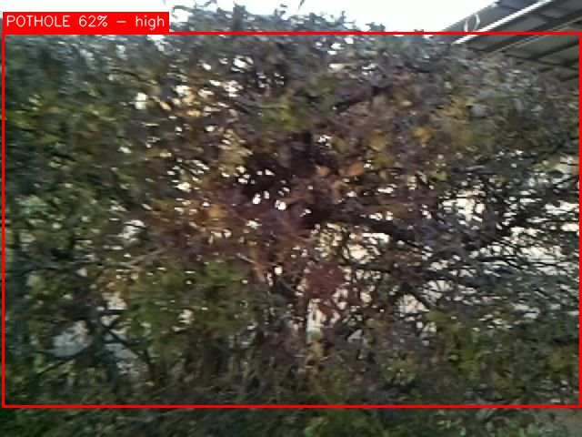
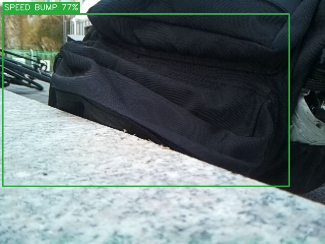
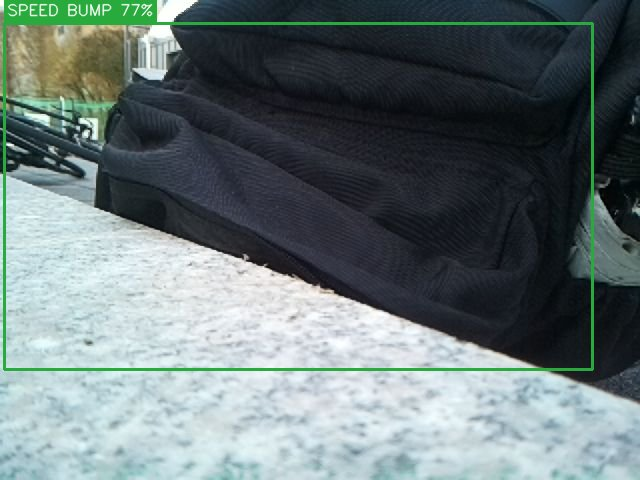
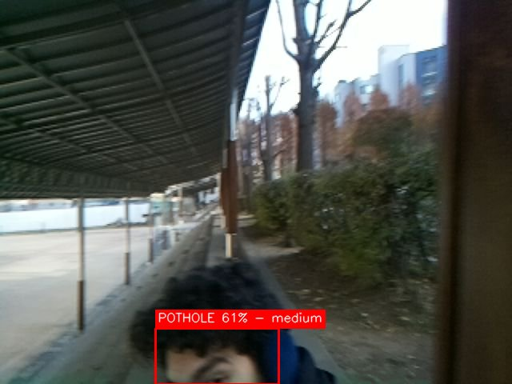
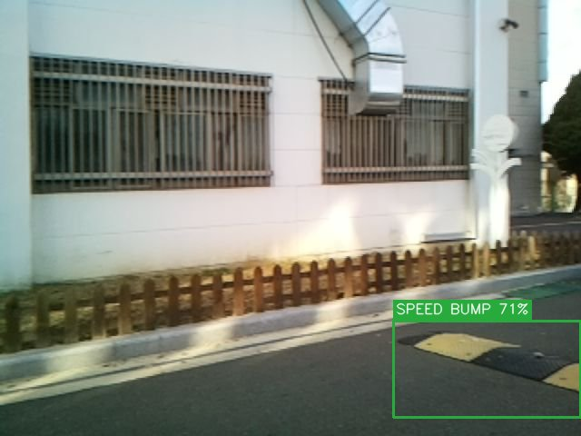
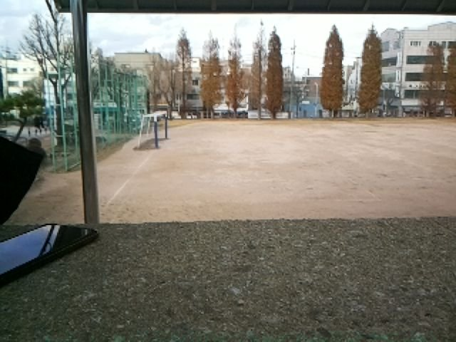
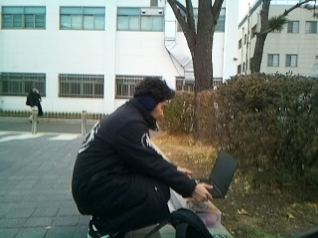

# Demo day: video test and results

Road mapper on the Raspberry Pi 4, 2026-11-25. Each jolt saved the 6 s of video before it; the detector picked the best frame and labelled the defect. Locations are from the GPS.

- **Jolts captured:** 15
- **Camera verdicts:** speed_bump: 6, pothole: 3, crack: 3, none: 2, running: 1
- **Incidents on the map:** 5 (reports within 5 m are merged)

Files: `captures/` (photos and `.avi` videos), `captures.json` (every jolt), `incidents_api.json` and `incidents.json` (the map data).

## Map incidents

| Type | Severity | Reports | Location | Photo |
|---|---|---|---|---|
| pothole | high | 3 | [37.449945, 126.659163](https://www.google.com/maps?q=37.449945,126.659163) |  |
| bump | medium | 6 | [37.449793, 126.659167](https://www.google.com/maps?q=37.449793,126.659167) |  |
| bump | low | 1 | [37.449900, 126.659184](https://www.google.com/maps?q=37.449900,126.659184) |  |
| pothole | low | 1 | [37.449716, 126.659262](https://www.google.com/maps?q=37.449716,126.659262) |  |
| bump | medium | 2 | [37.449696, 126.659166](https://www.google.com/maps?q=37.449696,126.659166) |  |

## Every jolt

| # | Time (UTC) | Jolt | Peak g | Speed km/h | Camera verdict | Location | Photo | Video |
|---|---|---|---|---|---|---|---|---|
| 1 | 06:14:27 | down | -0.9 | 12.0 | pothole (0.56) | [37.449911, 126.659158](https://www.google.com/maps?q=37.449911,126.659158) |  | [3.9 s video](captures/20261125-151428-083_down.avi) |
| 2 | 06:15:11 | up | 0.42 | 0.7 | speed_bump (0.77) | [37.449800, 126.659152](https://www.google.com/maps?q=37.449800,126.659152) |  | [6.0 s video](captures/20261125-151511-979_up.avi) |
| 3 | 06:15:14 | up | 0.59 | 2.0 | speed_bump (0.77) | [37.449801, 126.659161](https://www.google.com/maps?q=37.449801,126.659161) |  | [6.0 s video](captures/20261125-151515-210_up.avi) |
| 4 | 06:15:16 | up | 0.43 | 2.8 | speed_bump (0.72) | [37.449809, 126.659177](https://www.google.com/maps?q=37.449809,126.659177) |  | [6.0 s video](captures/20261125-151517-219_up.avi) |
| 5 | 06:15:35 | up | -1.07 | 9.4 | crack (0.40) | [37.449953, 126.659167](https://www.google.com/maps?q=37.449953,126.659167) |  | [6.0 s video](captures/20261125-151535-449_up.avi) |
| 6 | 06:15:38 | up | 0.58 | 3.9 | crack (0.15) | [37.449971, 126.659165](https://www.google.com/maps?q=37.449971,126.659165) |  | [6.0 s video](captures/20261125-151538-580_up.avi) |
| 7 | 06:15:41 | up | 0.42 | 8.1 | crack (0.21) | [37.449900, 126.659184](https://www.google.com/maps?q=37.449900,126.659184) |  | [6.0 s video](captures/20261125-151541-390_up.avi) |
| 8 | 06:16:02 | down | -0.41 | 7.3 | pothole (0.62) | [37.449716, 126.659262](https://www.google.com/maps?q=37.449716,126.659262) |  | [6.0 s video](captures/20261125-151602-810_down.avi) |
| 9 | 06:16:14 | up | 0.49 | 2.3 | pothole (0.61) | [37.449779, 126.659166](https://www.google.com/maps?q=37.449779,126.659166) |  | [6.0 s video](captures/20261125-151615-209_up.avi) |
| 10 | 06:16:25 | up | -0.73 | 0.7 | speed_bump (0.71) | [37.449778, 126.659148](https://www.google.com/maps?q=37.449778,126.659148) |  | [6.0 s video](captures/20261125-151626-059_up.avi) |
| 11 | 06:16:28 | down | -0.6 | 2.5 | speed_bump (0.75) | [37.449788, 126.659195](https://www.google.com/maps?q=37.449788,126.659195) |  | [6.0 s video](captures/20261125-151628-550_down.avi) |
| 12 | 06:17:58 | manual |  | 1.5 | none | [37.449672, 126.659230](https://www.google.com/maps?q=37.449672,126.659230) |  |  |
| 13 | 06:20:42 | up | 0.69 | 0.9 | none | [37.449692, 126.659169](https://www.google.com/maps?q=37.449692,126.659169) |  | [6.0 s video](captures/20261125-152043-019_up.avi) |
| 14 | 06:20:44 | down | -0.46 | 2.2 | speed_bump (0.49) | [37.449699, 126.659163](https://www.google.com/maps?q=37.449699,126.659163) |  | [6.0 s video](captures/20261125-152045-239_down.avi) |
| 15 | 06:20:56 | up | 0.86 | 7.7 | running | [37.449913, 126.659271](https://www.google.com/maps?q=37.449913,126.659271) |  | [6.0 s video](captures/20261125-152056-669_up.avi) |
